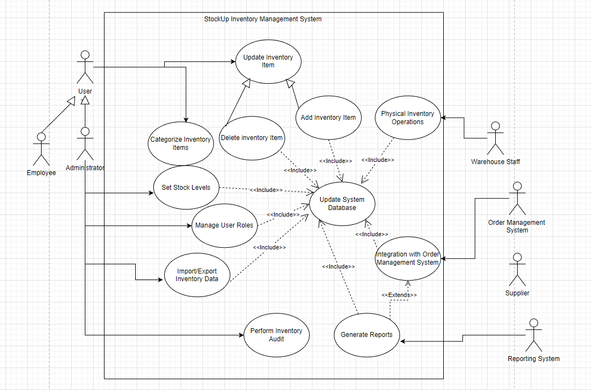

# StockUp Inventory Requirements Case Study

An undergraduate **Process Analysis and Requirement Engineering** project specifying an inventory-management system. Requirements elicitation included real interviews and questionnaires. The coursework develops the proposed functionality, stakeholder roles, interfaces, constraints and use cases.

This repository presents the **requirements and design work**. An executable StockUp application has not been identified in the reviewed source collection; the described features are specification requirements rather than implemented capabilities.

## Proposed system

StockUp brings product records, stock quantities and locations, purchases/sales/returns, reorder alerts, supplier information, reporting and inventory audits into one proposed system. The wider scope also discusses barcode/RFID identification, serial/batch information, forecasting and integration with other business systems.

The intended benefits are better stock visibility and less manual coordination. No measured cost saving, forecast accuracy, throughput or operational deployment is claimed.

## Read the work

- [Original requirement statements and source mapping](docs/REQUIREMENTS.md)
- [Use-case specifications](docs/USE_CASES.md)
- [Later review and unresolved design decisions](docs/REVIEW.md)
- [Proposed acceptance checks](docs/ACCEPTANCE_PLAN.md)
- [Source versions and preparation notes](docs/SOURCE_NOTE.md)
- [Traceability table](docs/traceability.csv)

The diagram is preserved without redesign. The review explains the remaining role, scope and model questions. Acceptance checks are proposals for future implementation; they have not been executed against an application.

## Contribution and preparation

Portfolio case study: **Ahmad Sajjad Siddiqui**. Module: **Process Analysis and Requirement Engineering**.

The requirements and diagram come from the bachelor's coursework. The public Markdown structure, traceability labels, acceptance proposals and later review were prepared with Codex assistance in October 2026. They are distinguished from the historical submission.

The original Word files remain unchanged privately. Their administrative covers, student identifiers, college logo and participant-level research material are not distributed here. No blanket licence is granted by this repository.

A future flagship application would need a justified target user/problem, current domain research and comparative evaluation. This case study does not establish an unmet market need or a completed flagship product.
